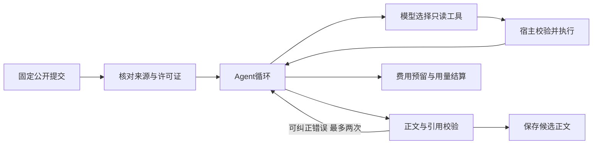

# 项目学习证据助手

面向公开 Java 后端项目的本地源码学习 Agent。模型通过三个只读工具查阅固定 Git 提交，生成带源码引用的章节说明；宿主程序控制文件权限、执行次数、取消与费用。

技术栈：Python 3.12、FastAPI、Pydantic、HTTPX、SQLite、原生 JavaScript。

## 0.5 的变化

- 普通正文只要求文本块及其 `evidence_ids`。程序填写章节身份并推导块的位置，不要求模型填写覆盖编号、字段路径和引文定位。
- 本地保留脱敏后的模型原始响应。正文校验失败时反馈具体错误，最多纠正两次；每次仍计入同一任务和累计费用。
- 固定开发评测覆盖四条业务链路和证据不足问题，每题三次，与同模型的关键词检索基线比较。见[评测报告](docs/evaluation-v05.md)。
- 停止 S03 单题满分攻关，保留其[已知限制与失败分析](docs/known-limitations.md)。

这是开发版本。格式和引用 ID 通过校验不代表解释语义正确，也不代表使用者已经掌握项目。0.4 系列实验协议保留兼容入口，不再作为默认正文路径。

## 本机启动

需要 Python 3.12 和 Git。

```powershell
git clone https://github.com/chiye0384-dot/project-evidence-assistant.git
Set-Location project-evidence-assistant
py -3.12 -m venv .venv
& .\.venv\Scripts\python.exe -m pip install -r requirements.lock.txt
& .\.venv\Scripts\python.exe -B run.py
```

打开 <http://127.0.0.1:8765>。默认无需 Key，可以登记公开项目、核对固定提交、查阅源码和旧记录。端口占用可加 `--port 8766`。

模型从本机 `DEEPSEEK_API_KEY` 环境变量读取。配置及费用说明见[模型配置](docs/model-configuration.md)。升级已有工作区必须保留原 `data/` 账本，不能新建授权绕过累计预算。开发者的数据库、Key、原始响应和实验档案不会随源码发布。

## 执行流程



源码来自固定 Git 对象；模型不能执行 Shell、Java、SQL 或 Docker。路径、敏感内容、行范围、数量、时间和费用由应用控制。权限失败、来源变化和费用不确定会停止任务，不按输出错误自动重试。

## 阅读与验证

先读[四部分代码导读](docs/code-guide.md)，再沿文件和行号查看实现。导读包含失败案例、小修改练习和三分钟演示顺序。[图文阅读说明](docs/learning-guide.md)介绍网页中的表格、图表和折叠参考答案。

```powershell
& .\.venv\Scripts\python.exe -B -m pytest -q
node tests/frontend-list-race.cjs
node tests/frontend-agent-tasks.cjs
node tests/frontend-learning.cjs
node tests/frontend-learning-content.cjs
```

测试结果与范围见[工程验证记录](docs/verification.md)。工程测试主要使用临时 Git、SQLite 和模拟 HTTP；真实模型指标单列在评测报告，二者不相加。

评测准备检查：

```powershell
& .\.venv\Scripts\python.exe -B scripts/evaluate.py --prepare-only `
  --data-dir .\data --source D:\path\to\public-project
```

去掉 `--prepare-only` 才会读取环境变量并调用模型。题集固定在 `evaluation/fixed_v05.json`；它是已知项目的开发评测，不能声称未见题泛化能力。

第三方依赖说明见 [THIRD-PARTY.md](THIRD-PARTY.md)。
