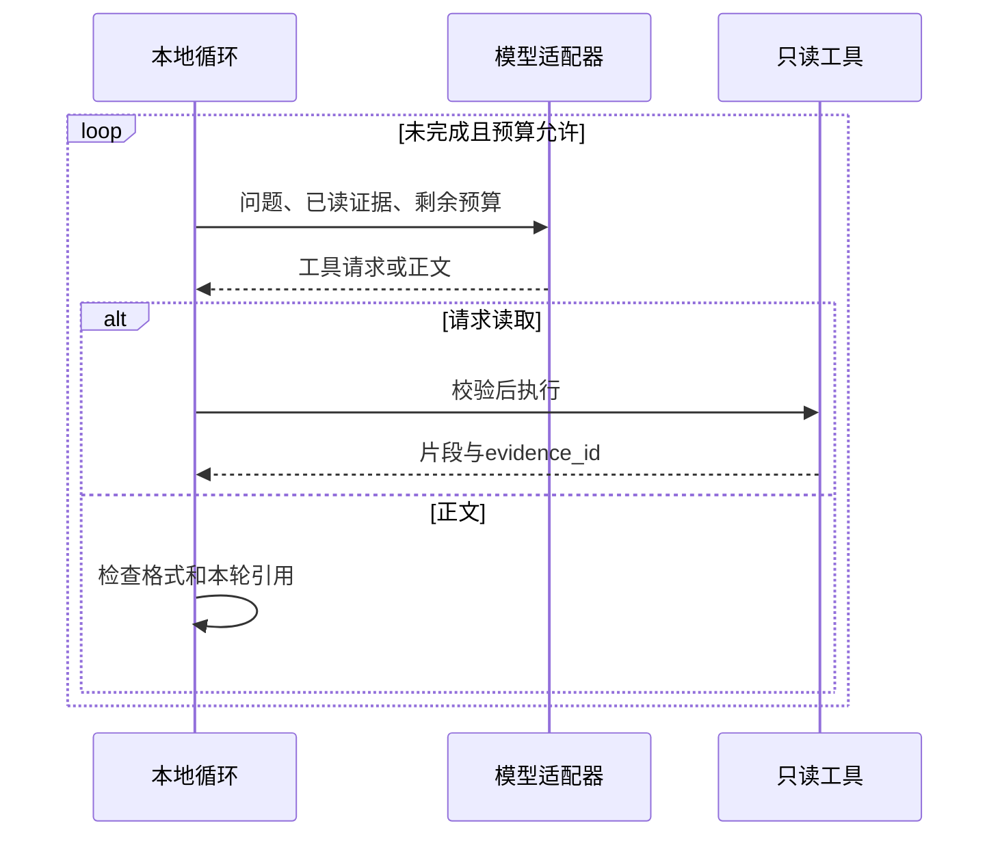

# 0.5 代码导读

围绕四个问题：谁决定下一步、谁能读文件、费用如何守住、失败如何定位。行号对应 0.5 源码；历史实验分支不必先读。

**模型**是远端生成响应的服务；**适配器**把应用上下文翻译成请求并解析响应；**Agent 循环**是本地反复“请求→检查→执行→反馈”的程序；**工具**是本地受限函数，模型只能请求调用，不能自行执行。

## 一、Agent 循环：下一步由谁决定

入口：[agent_engine.py:819](../src/project_evidence/agent_engine.py#L819) 的 `run_agent` 创建执行器；[683 行](../src/project_evidence/agent_engine.py#L683) 的 `execute` 校验目标和上下文，然后循环。

模型返回两类主要行动：请求工具，或提交最终正文。工具行动由宿主校验和执行，再把结果放进下一轮上下文。正文通过结构及引用检查后保存；取消、超时、预算用尽、来源变化会停止。



[304 行](../src/project_evidence/agent_engine.py#L304) `_model_request` 处理模型预算与异常；[263 行](../src/project_evidence/agent_engine.py#L263) `_retry` 决定还有没有纠正次数。[simple_section.py](../src/project_evidence/simple_section.py) 只把正文块、文字和证据 ID 交给模型，标题和位置由程序决定。

**为什么这样写？** 模型容易选错或编造结构字段，宿主已知的章节身份不需要再让它猜。Pydantic 是将字典按规则检查并转换为对象的库，能检查字段类型和数量，不能证明解释正确。

读完口述：“模型选工具，应用执行；模型说完成，应用仍要校验。”再预测：第一次正文引用不存在的 ID，第二次更正成功，费用几笔？每次已发送请求各结算一笔，纠正不免费，也不重置预算。

## 二、工具边界：模型能看什么

入口：[tools.py:125](../src/project_evidence/tools.py#L125) `SourceTools`。三个操作是 [236 行](../src/project_evidence/tools.py#L236) `find_files`、[262 行](../src/project_evidence/tools.py#L262) `search_text`、[320 行](../src/project_evidence/tools.py#L320) `read_excerpt`：查文件名、搜文字、读指定行。

[source_policy.py:68](../src/project_evidence/source_policy.py#L68) 在读取前拒绝禁止路径；[source.py:372](../src/project_evidence/source.py#L372) 枚举固定 Git 提交的对象，不用工作区未提交文件替代被核对版本。[source_service.py:63](../src/project_evidence/source_service.py#L63) 绑定本次公开版本会话，防止任务途中换来源。

[agent_engine.py:474](../src/project_evidence/agent_engine.py#L474) `_tool_result` 检查请求、次数、大小、证据身份和截断；成功读取才产生当前任务可用的 `evidence_id`。其他任务的 ID 或超出允许行范围的读取会被拒绝。

**为什么不发整个仓库？** 无关内容增加成本和干扰，也扩大秘密泄漏范围。应用控制读取，源码注释只是数据，不能变成执行指令。工具没有执行 Java、SQL、Shell 或 Docker 的能力。

读完分别解释“固定提交”“行范围”“证据 ID”。预测：代码在本机但不在允许范围，能不能为了答题临时读取？不能，应说明缺证据或由用户另行调整范围。

## 三、费用：预留与结算

入口：[spending.py:155](../src/project_evidence/spending.py#L155) `reserve`、[182 行](../src/project_evidence/spending.py#L182) `settle`、[205 行](../src/project_evidence/spending.py#L205) `uncertain`、[209 行](../src/project_evidence/spending.py#L209) `summary`。

**预留**是在请求前按保守上限占住预算，避免超支；**结算**是拿到可信供应商 `usage` 后，按 token 单价记本次上界费用并释放多余预留。token 是模型计费的文本单位，不等于一个汉字。

```text
发请求前：检查累计／单任务／单次上限 → pending预留
收到可信usage：输入token×单价 + 输出token×单价 → settled
超时或usage未知：保留预留 → uncertain → 停止后续调用
```

金额以整数 microyuan 保存：1 元 = 1,000,000 microyuan，避免浮点误差。SQLite 是本机数据库；删学习内容、重开软件或纠正输出都不能清零账本。

手算：100 输入 token、50 输出 token，单价分别 2、8 microyuan，记账 600 microyuan，即 0.0006 元。超时无 usage，不能写零或直接重发；也不能认定供应商扣了全部预留，应先核对回执。

## 四、失败案例：有引用也可能讲错

先读[已知限制](known-limitations.md)。S03 曾把普通 `afterCommit(...)` 调用说成“传入回调”。文件引用正确、JSON 合法，都无法证明这个解释。要看调用参数和声明，不能凭方法名联想机制。

旧流程多次结构失败未保留原始参数，后来只能知道粗略标签。0.5 在 [response_archive.py:31](../src/project_evidence/response_archive.py#L31) 先保存脱敏响应，再在 [simple_section.py:246](../src/project_evidence/simple_section.py#L246) 请求入口解析校验；具体错误最多反馈两次。

定位顺序：查 `data/model-responses/任务ID/` → 看真实函数和参数 → 对照本地错误 → 核对 `model_spend` 的 usage 与状态 → 区分格式、来源、费用、语义问题。不要默认归咎 Key，也不要靠下一次成功覆盖本次失败。

读完解释两个区别：“引用 ID 有效”与“引用支持这句话”；“程序检查通过”与“模型讲对”。本项目没有独立盲评，固定题集也不是未见测试。

## 接下来一周怎样接管

按四部分依次阅读，每天自己画一次链条并口述小检查。先说理解，再让 AI 指出遗漏；不要求先独立重写项目。

小修改：给 `simple_section.py` 的 `submit_section` 函数 Schema 加一句用途说明，在 `tests/test_simple_section.py` 断言说明存在。改前解释它改变模型看到的信息，为什么没有改变权限、预算和语义保证；改后亲自看差异并跑相关测试。练习尚未完成，不计为个人成果。

三分钟演示：30 秒说明固定来源和问题；60 秒展示读取与引用；45 秒展示缺证据题和失败响应；45 秒解释预算、纠正和限制。演示前脱离稿子解释四条链路，不能只播放生成结果。
